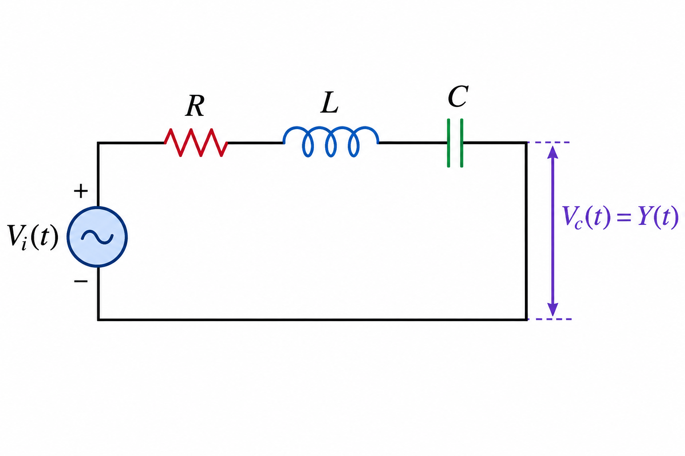
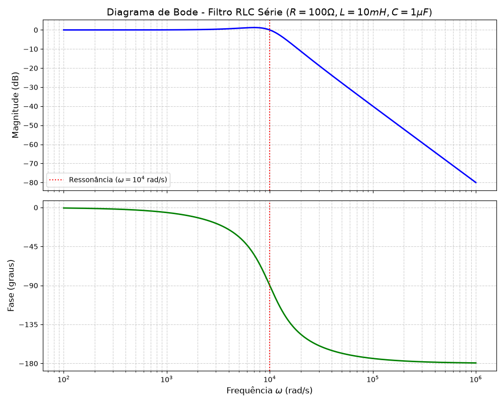

# Exercício 3: Circuito Elétrico RLC Série
> Grupo: Leonardo Magalhães, Marcos Paulo, Rafael Guerra, Rian Dultra e Vinicius Fernandes
>
> Professor: Artur Passos Dias Lima
>
> Disciplina: Sinais e Sistemas
## Enunciado do Problema
- Em uma malha elétrica composta por um resistor $R$, um indutor $L$ e um capacitor $C$ ligados em série, aplica-se uma tensão de entrada $V_i(t)$. A saída de interesse é a tensão sobre o capacitor $V_c(t) = Y(t)$. 



*Pede-se:*

1. Modelar o circuito elétrico utilizando a Lei das Tensões de Kirchhoff (KVL) e as
relações dos componentes para montar a EDO linear de segunda ordem.

2. Utilizar o operador harmônico $(j\omega)$ para determinar a Função de Transferência
$H(j\omega) = \frac{Y(j\omega)}{V_i(j\omega)}$ .

3. Analisar o comportamento em frequência com o diagrama de Bode e o respectivo
script computacional.

## Modelagem da EDO

Pela Lei das Tensões de Kirchhoff (KVL), a soma das quedas de tensão nos componentes de uma malha fechada deve ser igual à tensão da fonte aplicada.

**1. Equação do KVL**


$$V_R(t) + V_L(t) + V_c(t) = V_i(t)$$

**2. Relações dos Componentes**
Como os componentes estão em série, a corrente $i(t)$ é a mesma em toda a malha. As relações de tensão para o resistor e indutor são:

* **Resistor:** $V_R(t) = R \cdot i(t)$
* **Indutor:** $V_L(t) = L \cdot \frac{di(t)}{dt}$

A corrente no circuito é fundamentalmente governada pela relação do capacitor:


$$i(t) = C \cdot \frac{dV_c(t)}{dt}$$

**3. Substituição e Derivação**
Substituindo a definição da corrente $i(t)$ nas equações do resistor e do indutor:

* **Tensão no resistor:**

$$V_R(t) = R \cdot \left( C \cdot \frac{dV_c(t)}{dt} \right) = RC \cdot \frac{dV_c(t)}{dt}$$


* **Tensão no indutor** (aplicando a derivada sobre a corrente):

$$V_L(t) = L \cdot \frac{d}{dt} \left( C \cdot \frac{dV_c(t)}{dt} \right) = LC \cdot \frac{d^2V_c(t)}{dt^2}$$


**4. EDO Final**
Substituindo essas novas expressões na equação original do KVL, obtemos:


$$LC \cdot \frac{d^2V_c(t)}{dt^2} + RC \cdot \frac{dV_c(t)}{dt} + V_c(t) = V_i(t)$$

Como o problema define a saída de interesse como $V_c(t) = Y(t)$, substituímos a variável para montar a Equação Diferencial Ordinária (EDO) linear de segunda ordem final:


$$LC \cdot \frac{d^2Y(t)}{dt^2} + RC \cdot \frac{dY(t)}{dt} + Y(t) = V_i(t)$$

## Função de Transferência

Para determinar a Função de Transferência utilizando o operador harmônico, substituímos as derivadas no domínio do tempo pela multiplicação por $j\omega$ no domínio da frequência, assumindo condições iniciais nulas.

As transformações diretas são:

* $Y(t) \rightarrow Y(j\omega)$
* $\frac{dY(t)}{dt} \rightarrow (j\omega) Y(j\omega)$
* $\frac{d^2Y(t)}{dt^2} \rightarrow (j\omega)^2 Y(j\omega)$

**1. Substituição na EDO**
Partindo da EDO encontrada na etapa anterior:


$$LC \cdot \frac{d^2Y(t)}{dt^2} + RC \cdot \frac{dY(t)}{dt} + Y(t) = V_i(t)$$

Aplicando o operador harmônico para cada termo:


$$LC(j\omega)^2 Y(j\omega) + RC(j\omega) Y(j\omega) + Y(j\omega) = V_i(j\omega)$$

**2. Isolando as Variáveis**
Colocando a variável de saída $Y(j\omega)$ em evidência do lado esquerdo da equação:


$$Y(j\omega) \left[ LC(j\omega)^2 + RC(j\omega) + 1 \right] = V_i(j\omega)$$

**3. Montando a Função de Transferência**
A função de transferência $H(j\omega)$ é definida como a razão entre o sinal de saída e o sinal de entrada no domínio da frequência ($H(j\omega) = \frac{Y(j\omega)}{V_i(j\omega)}$). Passando os termos para formar essa razão, temos:


$$H(j\omega) = \frac{1}{LC(j\omega)^2 + RC(j\omega) + 1}$$

Lembrando que $j^2 = -1$, podemos substituir $(j\omega)^2$ por $-\omega^2$ e agrupar as partes real e imaginária no denominador para obter a forma algébrica final da equação:


$$H(j\omega) = \frac{1}{(1 - LC\omega^2) + j\omega RC}$$

## Construir o Diagrama de Bode


### Passo 1: Separar o que é Real e o que é Imaginário ($a + jb$)

Nossa função de partida é:

$$H(j\omega) = \frac{1}{(1 - LC\omega^2) + j(\omega RC)}$$

Aqui temos claramente o formato $Z = a + jb$ para o numerador e para o denominador:

* **Numerador:** $a = 1$ e $b = 0$
* **Denominador:** $a = (1 - LC\omega^2)$ e $b = (\omega RC)$

---

### Passo 2: Calcular os Módulos ($\vert{}Z\vert{} = \sqrt{a^2 + b^2}$)

A magnitude de uma divisão é a divisão das magnitudes. Vamos calcular a magnitude do numerador e do denominador separadamente.

* **Módulo do Numerador ( $\vert{}N\vert{}$):**

$$\vert{}N\vert{} = \sqrt{1^2 + 0^2} = \sqrt{1} = 1$$


* **Módulo do Denominador ( $\vert{}D\vert{}$):**

$$\vert{}D\vert{} = \sqrt{(1 - LC\omega^2)^2 + (\omega RC)^2}$$


Juntando os dois, a magnitude total da função de transferência (sem estar em decibéis ainda) é:


$$\vert{}H(j\omega)\vert{} = \frac{1}{\sqrt{(1 - LC\omega^2)^2 + (\omega RC)^2}}$$

---

### Passo 3: Encontrar a Magnitude em Decibéis ($20\log\vert{}H(j\omega)\vert{}$)

Para transformar a magnitude para o Diagrama de Bode, aplicamos $20\log_{10}$ em toda a função.


$$\vert{}H(j\omega)\vert{}_{dB} = 20\log_{10}\left( \frac{1}{\sqrt{(1 - LC\omega^2)^2 + ( \omega RC)^2}} \right )$$

Pela propriedade dos logaritmos para divisões ( $\log(\frac{x}{y}) = \log(x) - \log(y)$ ), separamos o numerador do denominador:


$$\vert{}H(j\omega)\vert{}_{dB} = 20\log_{10}(1) - 20\log_{10}\left( \sqrt{(1 - LC\omega^2)^2 + (\omega RC)^2} \right)$$

Neste momento, aplicamos duas regras matemáticas básicas:

1. O logaritmo de 1 é zero ($\log_{10}(1) = 0$).
2. Uma raiz quadrada é a mesma coisa que elevar à potência de meio ($x^{1/2}$). Nos logaritmos, o expoente "desce" multiplicando. Portanto, o $20$ multiplicado por $1/2$ vira $10$.

A equação final e purificada da magnitude, pronta para o professor, fica:


$$\vert{}H(j\omega)\vert{}_{dB} = -10\log_{10}\left( (1 - LC\omega^2)^2 + (\omega RC)^2 \right)$$


---

### Passo 4: Encontrar o $\omega$ principal (Frequência de Ressonância)

No diagrama de Bode, o ponto mais importante de um sistema de 2ª ordem é a **frequência natural de ressonância ($\omega_n$)**.

Matematicamente, ela ocorre exatamente quando a **parte real do denominador se anula (vira zero)**.


$$a = 0$$

$$1 - LC\omega^2 = 0$$

$$LC\omega^2 = 1 \implies \omega^2 = \frac{1}{LC} \implies \omega = \frac{1}{\sqrt{LC}}$$


---

### Passo 5: Encontrar a Diferença de Fases ( $\theta = \text{arctg}(b/a)$ )

A regra para divisão de números complexos diz que **a fase total é a fase do numerador menos a fase do denominador**.

* **Fase do Numerador ($\theta_N$):** Como ele é apenas o número real $1$, temos $a=1$ e $b=0$.

$$\theta_N = \arctan\left(\frac{0}{1}\right) = \arctan(0) = 0^\circ$$


* **Fase do Denominador ($\theta_D$):** Usamos o $a$ e o $b$ que separamos lá no Passo 1.

$$\theta_D = \arctan\left( \frac{\omega RC}{1 - LC\omega^2} \right)$$


* **Fase Total ( $\angle H(j\omega)$ ):**

$$\angle H(j\omega) = \theta_N - \theta_D = 0^\circ - \arctan\left( \frac{\omega RC}{1 - LC\omega^2} \right)$$


Equação final da fase:


$$\angle H(j\omega) = -\arctan\left( \frac{\omega RC}{1 - LC\omega^2} \right)$$

## Aplicando valores Reais

Apesar dos exercícios em sala terem sido feitos normalizando as constantes, na vida real (como ao projetar filtros analógicos para embarcados) lidamos com componentes físicos que possuem ordens de grandeza muito distintas. A recomendação do professor Artur foi de assumirmos valores comerciais comuns para os componentes, refletindo a prática real de projetos eletrônicos. 

Assumimos valores comerciais comuns para um circuito de áudio ou instrumentação básica, projetando intencionalmente um sistema **subamortecido** (para que haja um pico de ressonância visível):

* **Resistor ($R$):** $100 \, \Omega$
* **Indutor ($L$):** $10 \text{ mH}$ ($10 \times 10^{-3} \text{ H}$)
* **Capacitor ($C$):** $1 \, \mu\text{F}$ ($1 \times 10^{-6} \text{ F}$)


### 1. Cálculo das Constantes do Sistema

Antes de reescrever a equação, vamos calcular os produtos $LC$ e $RC$ que acompanham a variável $\omega$:

* $LC = (10 \times 10^{-3}) \cdot (1 \times 10^{-6}) = 10 \times 10^{-9} = 10^{-8} \text{ s}^2$
* $RC = 100 \cdot (1 \times 10^{-6}) = 10^{-4} \text{ s}$

### 2. A Nova Função de Transferência $H(j\omega)$

Substituindo as constantes na equação base $H(j\omega) = \frac{1}{(1 - LC\omega^2) + j\omega RC}$, obtemos a representação explícita com os componentes reais:

$$H(j\omega) = \frac{1}{(1 - 10^{-8}\omega^2) + j(10^{-4}\omega)}$$

### 3. Cálculo da Magnitude em Decibéis

O módulo complexo é a raiz quadrada da soma dos quadrados da parte real e imaginária do denominador.


$$\vert{}H(j\omega)\vert{} = \frac{1}{\sqrt{(1 - 10^{-8}\omega^2)^2 + (10^{-4}\omega)^2}}$$

Aplicando $20\log_{10}$ para converter em decibéis e descendo a raiz quadrada como o multiplicador $1/2$ (transformando o $20$ em $10$), a equação final da magnitude em dB passa a ser:

$$\vert{}H(j\omega)\vert{}_{dB} = -10 \log_{10} \left( (1 - 10^{-8}\omega^2)^2 + 10^{-8}\omega^2 \right)$$

> (Nota: $(10^{-4}\omega)^2$ virou $10^{-8}\omega^2$ na parte imaginária ao quadrado).

### 4. Cálculo da Fase Angular

A fase é dada por $-\arctan$ da razão entre a parte imaginária e a parte real do denominador. Substituindo nossas constantes:

$$\angle H(j\omega) = -\arctan\left( \frac{10^{-4}\omega}{1 - 10^{-8}\omega^2} \right)$$

### 5. Cálculo da Frequência de ressonância

$$\omega = \frac{1}{\sqrt{10^{-8}}} = \frac{1}{10^{-4}} = 10.000 \text{ rad/s}$$

Ou, escrito em potências de 10; **$\omega = 10^4 \text{ rad/s}$**. É neste exato ponto do eixo X do diagrama de Bode que a curva de magnitude fará uma "curva" ou apresentará um pico, e a fase passará por $-90^\circ$.


## Código Python para o Diagrama de Bode 
Utilizaremos o numpy para a manipulação dos vetores e matemática complexa, e o matplotlib para gerar a visualização em décadas.

``` Python
import numpy as np
import matplotlib.pyplot as plt

# 1. Definição dos valores físicos dos componentes
R = 100.0      # Resistência: 100 Ohms
L = 10e-3      # Indutância: 10 mH (10 * 10^-3 H)
C = 1e-6       # Capacitância: 1 uF (1 * 10^-6 F)

# Constantes auxiliares calculadas a partir das equações
LC = L * C     # Resultará em 10^-8
RC = R * C     # Resultará em 10^-4

# 2. Definição do vetor de frequência w (rad/s) em escala logarítmica
# A ressonância esperada é em 10^4 rad/s. 
# Varremos de 10^2 (100) até 10^6 (1.000.000) com 1000 pontos.
w = np.logspace(2, 6, 1000)

# 3. Modelagem explícita da Função de Transferência H(jw)
# Numerador = 1
# Denominador = (1 - LC*w^2) + j(w*RC)
H = 1 / ((1 - LC * w**2) + 1j * (w * RC))
    
# 4. Cálculo da Magnitude e Fase
# Magnitude em decibéis: 20 * log10(|H|)
mag_dB = 20 * np.log10(np.abs(H))

# Fase em graus: arctg(Parte Imaginária / Parte Real)
# np.unwrap mantém a continuidade da curva sem saltos matemáticos
phase_deg = np.rad2deg(np.unwrap(np.angle(H)))

# 5. Configuração da Plotagem (Diagrama de Bode)
fig, (ax_mag, ax_phase) = plt.subplots(2, 1, figsize=(10, 8), sharex=True)

# Plotagem da Magnitude
ax_mag.semilogx(w, mag_dB, color='blue', linewidth=2)
ax_mag.set_title('Diagrama de Bode - Filtro RLC Série ($R=100\Omega, L=10mH, C=1\mu F$)', fontsize=14)
ax_mag.set_ylabel('Magnitude (dB)', fontsize=12)
ax_mag.grid(True, which="both", ls="--", alpha=0.6)

# Marcação do ponto de ressonância (w = 10^4)
ax_mag.axvline(x=10000, color='red', linestyle=':', label='Ressonância ($\omega = 10^4$ rad/s)')
ax_mag.legend(loc='lower left')

# Plotagem da Fase
ax_phase.semilogx(w, phase_deg, color='green', linewidth=2)
ax_phase.set_ylabel('Fase (graus)', fontsize=12)
ax_phase.set_xlabel('Frequência $\omega$ (rad/s)', fontsize=12)

# Eixo Y travado nos ângulos notáveis
ax_phase.set_yticks([0, -45, -90, -135, -180])
ax_phase.grid(True, which="both", ls="--", alpha=0.6)

# Marcação do ponto de ressonância na fase
ax_phase.axvline(x=10000, color='red', linestyle=':')

# Ajuste e exibição
plt.tight_layout()
plt.show()
```

Ao executar este código, é possível visualizar exatamente o que os cálculos matemáticos previram: a magnitude começa em 0 dB para frequências baixas, atinge um pico no momento exato em que a linha vermelha tracejada cruza $\omega = 10^4$ (porque a parte real $1 - LC\omega^2$ zerou) e, a partir daí, cai linearmente. A fase acompanhará esse momento cruzando exatamente o eixo de $-90^\circ$ na ressonância, antes de assentar em $-180^\circ$ para frequências altas.

## Diagrama de Bode



O diagrama de Bode encontrado caracteriza de forma clássica o comportamento de um **filtro passa-baixa de segunda ordem**. Através da relação entre a magnitude e a fase, o sistema demonstra como componentes físicos atenuam o sinal e defasam o tempo da resposta dependendo da frequência de estímulo.

**Análise da Magnitude (Ganho do Sistema)**

* **Banda de Passagem (Baixas Frequências):** De $\omega = 10^2$ até aproximadamente $10^3\text{ rad/s}$, a linha de magnitude se mantém plana e fixa sobre o eixo de $0\text{ dB}$. Isso significa que sinais com essas frequências passam livremente pelo filtro em direção à saída (sobre o capacitor) com ganho unitário, sem sofrer atenuação.


* **Comportamento Subamortecido na Ressonância:** Imediatamente antes de atingir a marcação vermelha em $\omega = 10^4\text{ rad/s}$, nota-se uma leve elevação (um "pico" suave) na curva azul da magnitude. Essa amplificação do sinal na vizinhança da frequência natural indica que a resistência do circuito ($100\Omega$) não é forte o suficiente para amortecer totalmente a ressonância gerada pela troca de energia reativa entre o indutor e o capacitor.


* **Banda de Rejeição (Altas Frequências):** Após o ponto de ressonância, o filtro passa a bloquear progressivamente o sinal. Ao analisar a inclinação da reta decrescente, observa-se que em $10^4\text{ rad/s}$ a magnitude está próxima a $0\text{ dB}$, caindo para cerca de $-40\text{ dB}$ na década de $10^5\text{ rad/s}$ e atingindo a base do gráfico em $-80\text{ dB}$ na marca de $10^6\text{ rad/s}$. Essa taxa de decaimento exata de **$-40\text{ dB/década}$** atesta matematicamente a presença de dois pólos no sistema (os dois componentes armazenadores de energia, $L$ e $C$).


**Análise da Fase Angular (Atraso do Sinal)**

* **Sincronismo Inicial:** Em frequências muito baixas, a fase inicia em $0^\circ$, indicando que a onda de saída acompanha perfeitamente a onda de entrada no tempo. Fisicamente, a variação é tão lenta que o capacitor se comporta quase como um circuito aberto, acompanhando a tensão total imposta.


* **Inflexão Crítica:** Exatamente sobre a linha pontilhada da frequência de ressonância ($\omega = 10^4\text{ rad/s}$), a curva verde da fase cruza perfeitamente o marco de $-90^\circ$. Neste instante exato, as impedâncias imaginárias do indutor e do capacitor se cancelam mutuamente, tornando o circuito puramente resistivo do ponto de vista da fonte.


* **Inversão Total:** Ao avançar pelas altas frequências na banda de rejeição, a defasagem estabiliza de forma assintótica em $-180^\circ$. Isso significa que o sinal de saída foi invertido em relação à entrada. Contudo, dado que a magnitude nessa zona já está severamente atenuada (próxima a $-80\text{ dB}$), essa inversão se torna praticamente imperceptível no sinal elétrico resultante.
